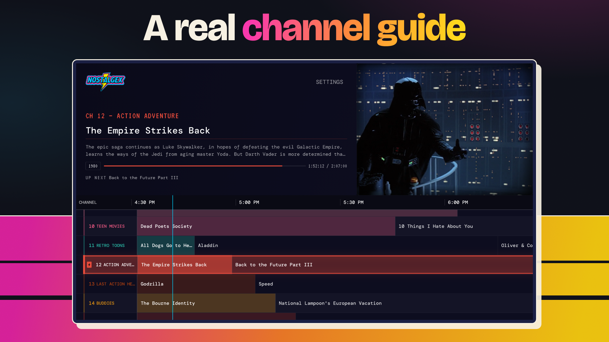

# JFTV (Jellyfin, Apple TV)

**Retro TV for your own Jellyfin library, on Apple TV.**

This is a fork of [Nostalgex](https://github.com/chadMueller/Nostalgex) stripped down to a
single surface: a **Jellyfin-only Apple TV app**. The Plex backend, the Emby backend, the
browser web tuner, the marketing site, the Docker container and the Roku port that lived in
the upstream repo have all been removed. What is left is the native tvOS app and the shared
channel configuration it reads.

JFTV turns your Jellyfin library into 130+ channels in 14 bundles, plus a channel for
every film series you own, with a real channel guide. Every channel plays on a set daily
schedule, so tuning in feels like live TV. It never supplies any media of its own; everything
streams from your Jellyfin server.



## Requirements

- An Apple TV running **tvOS 18 or later**.
- A **Jellyfin** server reachable from the Apple TV (a plain `http://` LAN address works, since
  the app is a native client, not a browser).
- **Xcode 26 or newer** to build.

## Build and run

1. Open `JFTV/JFTV.xcodeproj` in Xcode.
2. Pick your team under Signing & Capabilities.
3. Select the `JFTV` scheme and an Apple TV (or the tvOS simulator) as the run destination.
4. Build and run. On first launch, connect your Jellyfin server (sign in with a username and
   password, or Quick Connect), pick which libraries to scan, then flip channels with the Siri
   Remote.

No API keys are required. One optional extra is off unless you turn it on:

| What | How to enable | What it adds |
|---|---|---|
| TMDB / Supabase metadata enrichment | Copy `JFTV/Secrets.example.xcconfig` to `JFTV/Secrets.xcconfig` and fill in `SUPABASE_URL` and `SUPABASE_ANON_KEY`. For a direct TMDB connection set `TMDB_API_KEY` as an environment variable in the Xcode scheme (read in `Services/TMDBConfig.swift`). | Keyword and collection data for finer channel rules. Without it, the enrichment-based channels stay empty. |

The app has **no analytics, no telemetry and no payments** of any kind. Nothing leaves your
network except requests to your own Jellyfin server and, if you enable the optional enrichment
above, the public TMDB/IMDb ids it looks up.

## Tests

```sh
xcodebuild test -project JFTV/JFTV.xcodeproj -scheme JFTV \
  -destination 'platform=tvOS Simulator,name=Apple TV 4K (3rd generation)' \
  -only-testing:JFTVTests CODE_SIGN_IDENTITY="-" \
  CODE_SIGNING_REQUIRED=NO CODE_SIGNING_ALLOWED=NO
```

CI runs `JFTVTests` on every push and pull request (`.github/workflows/ci.yml`).

## How it works

- **Channel config:** `channels.json` (plus `channels-memberships.json` and `franchises.json`)
  at the repo root defines the channels, bundles and filter rules. An Xcode build phase
  ("Sync channel config") copies them into the app bundle, so a channel change ships with an
  app rebuild. `CHANNELS.md` is a human-readable breakdown of every channel and rule field.
- **Schedules:** each channel's pool is shuffled once per day (seeded by date + channel id) and
  looped end to end; your spot in the loop comes from the clock, so tuning in at the same time
  always lands at the same place. tvOS adds premiere priority, sequel adjacency and prime-time
  premieres on top.
- **Backend:** `Services/JellyfinAPIService.swift` is the server client, behind the
  `MediaBackend` protocol (`Services/MediaBackend.swift`). `App/AppState.swift` and its
  extensions drive playback, channel selection and filtering.

## Layout

| Path | Purpose |
|---|---|
| `JFTV/` | The Xcode project, Swift sources and assets (the app). |
| `channels.json`, `channels-memberships.json`, `franchises.json` | Shared channel + bundle config, copied into the app bundle at build time. |
| `CHANNELS.md` | Human-readable channel reference. |
| `scripts/` | Golden-vector JSON fixtures the Swift tests read, plus the tvOS release helpers (`release-tvos.sh`, `asc.mjs`). |
| `docs/` | `FAQ.md`, and `DEVLOG.md` (the upstream project's change log, kept as history). |

## Releasing

See `RELEASING.md` for the tvOS archive/upload flow and where the version numbers live.

## License

MIT, see `LICENSE`. Bundled fonts and packages are listed in `THIRD-PARTY-LICENSES.md`.

This is a fork. The Nostalgex name, icon and the nostalgex.app site belong to the upstream
project and are not part of the MIT grant; ship your fork under your own name.
